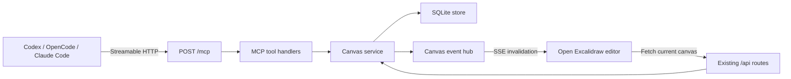

# Native MCP endpoint implementation plan

- Date: 2026-10-23
- Status: Implemented
- Decision: [ADR 0002](adr/0002-native-mcp-endpoint.md)

## Goal

Expose Homescribble's saved canvases to local AI clients through a Streamable HTTP MCP endpoint at `http://127.0.0.1:3000/mcp`. An agent must be able to find a canvas, inspect its current revision, and add, update, or delete Excalidraw elements. Changes must use the same SQLite records, validation, revision checks, backups, and recovery rules as browser edits.

The feature is local-first and single-user. It does not make Homescribble remotely accessible, add accounts, or provide real-time multi-user collaboration.

## User flow

1. Start Homescribble normally with `bun dev` or `bun start`.
2. Configure an MCP client with `http://127.0.0.1:3000/mcp`.
3. Ask the client to list canvases and select one by ID.
4. The client reads the canvas and its revision.
5. A mutation supplies that revision as `expectedRevision`.
6. Homescribble commits the new scene atomically and returns the new revision.
7. If that canvas is open in a browser, the editor receives an invalidation event and displays the committed scene. Unsaved browser work is never silently replaced.

## Architecture

The MCP layer is an adapter. Scene mutation and persistence rules belong in a shared canvas service used by both `/api` and `/mcp`; tool handlers must not issue loopback HTTP requests or write SQLite directly.

## Protocol and dependencies

- Use the official TypeScript MCP SDK and its Web Standard Streamable HTTP transport because Bun routes receive `Request` objects and return `Response` objects.
- Use a stateless handler. Canvas identity and concurrency state are explicit tool arguments, so MCP session state is unnecessary.
- Support the current MCP protocol and stateless compatibility for initialize-based clients. Do not add the deprecated standalone HTTP+SSE MCP transport.
- Mount all MCP methods on the exact `/mcp` path. Unsupported methods return the transport's standard response.
- Pin SDK and schema-validation versions in `package.json` and the Bun lockfile.
- Before building the tools, make a small transport spike and verify `initialize`, `tools/list`, and one read-only call from Codex, OpenCode, Claude Code, and MCP Inspector. This isolates Bun/SDK compatibility before scene work begins.

## Tool surface

Tools return structured JSON plus a short text summary. Lists are deterministic so clients can cache their tool catalog and results remain easy to inspect.

| Tool | Behavior | Safety annotation |
| --- | --- | --- |
| `list_canvases` | Return canvas metadata, optionally filtered by project or title. Never return scene blobs. | Read-only |
| `get_canvas` | Return the complete persisted scene, current revision, and browser URL for one canvas. | Read-only |
| `create_canvas` | Create a named empty canvas, optionally in a project, and return its ID, revision, and URL. | Write, non-destructive |
| `add_elements` | Normalize and append new elements, preserving existing elements, app state, and files. | Write, non-destructive |
| `update_elements` | Patch mutable fields on existing elements by ID. | Write |
| `delete_elements` | Mark elements deleted and repair affected bindings. | Destructive |

Every mutation of an existing canvas requires `canvasId` and `expectedRevision`. A stale revision returns a typed conflict containing the current revision and no partial changes. Tools do not automatically retry conflicts because doing so could merge against a scene the model has not inspected.

The first release intentionally omits arbitrary file access, arbitrary SQL, image upload, scene replacement, canvas deletion, project deletion, and a `clear_canvas` shortcut. Embedded images already in a scene round-trip through reads and unrelated mutations, but creating new image elements waits for a bounded asset-upload design.

## Element mutation rules

Add a server-side scene mutation module rather than asking models to manufacture every internal Excalidraw field.

- Accept concise element inputs for `rectangle`, `diamond`, `ellipse`, `text`, `line`, `arrow`, `freedraw`, and `frame`.
- Generate missing IDs and required Excalidraw metadata, including seeds, version fields, timestamps, grouping fields, and safe style defaults.
- Reject duplicate IDs, unsupported types, non-finite coordinates, invalid dimensions, oversized text, and malformed points before opening a database transaction.
- Preserve unknown fields on existing elements so scenes remain forward-compatible.
- Do not allow `update_elements` to change an element's `id` or `type`.
- Increment element version metadata for updates and deletions. Maintain arrow bindings, container references, and `boundElements` consistently; test these as scene-level invariants.
- Apply a batch atomically: either every requested element change is valid and the canvas revision advances once, or nothing is stored.
- Reuse `validateScene` for the final document validation, extending it only where stronger element validation is required.
- Put conservative limits on elements per call, total scene elements, text length, and request size. Return actionable validation errors rather than truncating input.

## Persistence and concurrency

Extract a `CanvasService` around the existing store operations. It owns validation, transactions, typed not-found/conflict errors, mutation-source metadata, and event publication. Existing REST behavior remains compatible.

For each write:

1. Read the canvas inside the SQLite transaction.
2. Compare `expectedRevision` with the stored revision.
3. Apply and validate the entire scene mutation in memory.
4. Store the scene and increment the canvas revision once.
5. Commit the transaction.
6. Publish an in-process invalidation only after commit.

No schema migration is required for the first release. The current canvas row remains the source of truth, and normal SQLite snapshots automatically include MCP edits.

## Synchronizing an open browser editor

Add a loopback-only SSE endpoint such as `GET /api/canvases/:id/events`. Events carry only the canvas ID and committed revision; the browser fetches the authoritative canvas through the existing API. SSE is an invalidation signal, not a second persistence channel.

The editor must retain an Excalidraw API reference so it can apply a newly fetched scene. Its `SaveSession` handles an MCP invalidation as follows:

- If the session is clean and its revision is older, fetch and adopt the server scene, update the Excalidraw view, and remain `Saved`.
- If the session has unsaved changes, a save is in flight, or a recovery draft exists, enter the existing `Conflict` state and preserve the local draft. Do not apply the remote scene over it.
- Ignore duplicate or older revision events.
- After an SSE reconnect, fetch once to recover events missed while disconnected.

Initially publish these invalidations only for MCP mutations. That avoids an editor receiving its own autosave event before the corresponding HTTP response has updated its local revision. General cross-tab live updates can later add writer IDs and acknowledgements as a separate feature.

## Security boundaries

- Keep the server bound to `127.0.0.1`; the MCP endpoint has no authentication in the local-only deployment model.
- Validate `Host` to prevent DNS-rebinding access and reject browser `Origin` values other than the server's own origin. Non-browser local clients commonly omit `Origin` and remain supported.
- Apply the existing request-size ceiling and add smaller per-tool semantic limits.
- Never accept filesystem paths, URLs to fetch, shell commands, or SQL through MCP inputs.
- Mark read-only and destructive tools accurately, but treat client approval UI as advisory rather than a security boundary.
- Do not recommend tunnels or public reverse proxies. Remote access requires a separate authentication and threat-model decision.

## Implementation sequence

1. **Transport spike**
   - Add and pin the MCP SDK dependencies.
   - Implement a temporary read-only `server_info` tool on `/mcp`.
   - Verify protocol negotiation and tool calls with all three documented clients and MCP Inspector.
2. **Shared service boundary**
   - Extract canvas reads and revision-checked writes from route code into `CanvasService` without changing REST responses.
   - Add typed validation, conflict, and not-found results.
3. **Scene mutation module**
   - Implement element normalization, batch add/update/delete, binding repair, limits, and deterministic error reporting.
   - Unit-test scene invariants independently of MCP.
4. **MCP tools**
   - Register the six tools and their input/output schemas.
   - Add structured results, safety annotations, server instructions, browser URLs, and conflict responses.
5. **Live editor invalidation**
   - Add the per-canvas SSE endpoint and post-commit event hub.
   - Teach `SaveSession` and the editor to adopt clean remote revisions or preserve dirty drafts as conflicts.
6. **Hardening and documentation**
   - Add Host/Origin checks, limits, request logging without scene contents, and graceful error mapping.
   - Exercise the README setup for Codex, OpenCode, and Claude Code.

## Verification

### Automated

- Unit tests for element defaults, ID collisions, patch whitelisting, version increments, bindings, soft deletion, limits, and all-or-nothing batches.
- Store/service tests proving one revision increment per tool call, stale-write rejection, image preservation, rollback on validation failure, and backup/reopen durability.
- Protocol tests using an MCP client transport against the real Bun server for initialization, tool discovery, tool calls, invalid JSON, unsupported methods, and concurrent clients.
- Browser tests proving that a clean open canvas displays an MCP-added element without reload.
- Browser tests proving that unsaved local work becomes a recoverable conflict instead of being overwritten by an MCP mutation.
- Regression runs: `bun run typecheck`, `bun test tests`, `bun run build`, and `bun run test:smoke`.

### Manual compatibility matrix

For Codex, OpenCode, and Claude Code:

1. Connect to the loopback URL.
2. List tools and canvases.
3. Create a test canvas.
4. Add a rectangle, text, and an arrow in one batch.
5. Open the returned URL and confirm the elements appear.
6. Update and delete elements.
7. Force a stale revision and confirm no data changes.
8. Remove the test canvas through the normal Homescribble UI.

## Acceptance criteria

- The three documented clients connect to the same Bun web server at `/mcp` without a sidecar process.
- Agents can discover canvases and perform bounded element-level mutations.
- Every mutation is atomic, revision-checked, validated, and included in existing backups.
- A clean open editor reflects MCP changes promptly; dirty local edits are preserved as a conflict.
- The endpoint remains loopback-only and exposes no arbitrary filesystem, network, database, or process capability.
- Existing REST, autosave, recovery, project, and browser test behavior remains intact.

## References

- [MCP TypeScript SDK: servers and Streamable HTTP](https://ts.sdk.modelcontextprotocol.io/server)
- [MCP TypeScript SDK: Web Standard transport for Bun](https://ts.sdk.modelcontextprotocol.io/v2/migration/upgrade-to-v2)
- [Official Excalidraw MCP](https://github.com/excalidraw/excalidraw-mcp)

